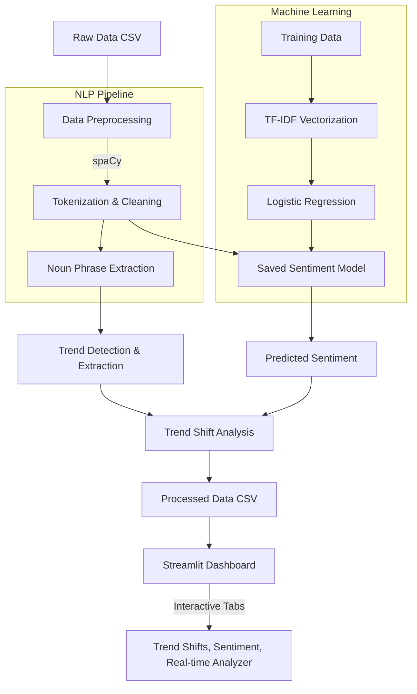

# Project Architecture

### Components:
1. **Raw Data**: Captions and comments from fashion influencers.
2. **Data Preprocessing**: Cleans URLs, mentions, and symbols.
3. **NLP Pipeline**: Uses spaCy for tokenization, lemmatization, and noun phrase extraction.
4. **Trend Detection**: Identifies fashion trends from the extracted noun phrases.
5. **Sentiment Model**: A machine learning model (TF-IDF + LR) trained to predict positive, neutral, or negative sentiment.
6. **Trend Shift Analysis**: Mathematical grouping of trend mentions over time to calculate growth rates and classify trends as Emerging, Rising, Stable, or Declining.
7. **Streamlit Dashboard**: The final interactive UI to explore the data, view model performance, and analyze new text in real-time.
